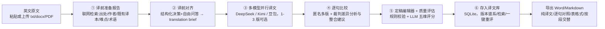

# 英译汉翻译与质量评估工作台

一个本地运行的英译汉（English→Chinese）翻译工作流应用：从**译前背景研究**开始，到**多模型并行译文**、**裁判逐句整合**、**人工定稿**、**规则校验 + LLM 五维质量评分**，最终归档进**本地 SQLite 译文库**，并支持 Word/Markdown 多版式导出。

面向翻译学习者/研究者的真实工作场景设计：模型选择、评分权重、术语约束全部可配置；全程中文界面。

## 工作流程



## 快速开始

要求 **Node.js ≥ 22.5**（使用内置 `node:sqlite`，无需安装任何数据库）。

```bash
npm install
cp .env.example .env.local   # 填入至少一家模型的 API Key
npm run dev                  # 打开 http://localhost:3000
```

- **模型密钥**：三家国内模型任选其一或多家（申请入口见 [.env.example](.env.example) 注释）。只填一家也能完整跑通，多模型环节自动降为单版。
- **无 key 演示**：三家 key 全空时，③ 译文环节自动切换为 mock 版本（可预览多版对比/整合/定稿的界面流转）；①②④⑤ 需要真实模型（完整离线演示模式在规划中）。
- 新增模型（含未来海外 OpenAI 兼容模型）只需在 `lib/providers.js` 的 `PROVIDERS` 数组加一条配置，零代码改动。

## 质量评估体系

评估 = **确定性规则校验** + **LLM 裁判**两层，互不依赖、互为印证（见 `lib/qe_rules.js`、`lib/qe_judge.js`、`lib/qe_profiles.js`）：

| 层 | 检查项 |
|---|---|
| 规则校验 | 英文残留（brief 指定保留的原文词豁免）· 术语合规（对照 brief 术语表逐句核查）· 数字/日期覆盖 · 空句漏译 |
| LLM 裁判 | 逐句 verdict（pass / minor / major + 问题定位与修改建议）· 分批五维分 |

**五维权重按文本类型自动切换**（文学/人文、新闻/时政、科技/工程、商务/法律四套 profile），例如文学类：准确 30% · 文体 30% · 流畅 25% · 术语 10% · 完整 5%。分数量表：70 及格线 / 85 出版级 / 95+ 优秀。

## 工程决策亮点

- **分块并发翻译**：长文按"≤20 句且 ≤3000 字符"预算切块，每模型 3 路并发；单块失败自动退避重试，仍失败仅该块降级为占位符并明示，不拖垮整篇。实测 88 句 11.7k 字符 5 块全成功（11.5 分钟，串行外推需 20+ 分钟），跨块术语零漂移。
- **任务进度上报**：内存 job 表 + 前端轮询，长任务实时显示"Kimi 2/5 块"。
- **推理模型适配**：Kimi k3 系思考链计入 `max_tokens`，报告/裁判调用分级放宽预算并自动精简重试；temperature 钉死为 1。
- **长超时网络通道**：undici 15 分钟 headers/body 超时，覆盖单次 10 分钟级的推理模型调用。
- **brief 术语表解析**：鲁棒处理多译法并列（`/`、`；` 分隔）、括注（暂译/待核）、"保留原文"豁免，避免规则校验误报。
- **本地数据优先**：译文库为单文件 SQLite（`data/translations.db`，首启自动创建），内置一键备份下载；版本谱系 `parent_id` 记录"改了就存新版本"的演进链，库内编辑定稿可一键重新评估。

## 目录结构

```
app/            Next.js App Router：页面 + 全部 API 路由（translate/compare/qe/db/export/...）
lib/            领域逻辑：providers(模型接入) research(译前检索) brief compare(整合)
                qe_rules/qe_judge/qe_profiles(评估) segmenter db export net jobs
data/           运行时数据（已 gitignore）：translations.db、用户文本、盲测产物
scripts/        开发期脚本：模型盲测、检索原型
```

## 样例与版权

仓库内示例文本均为公版材料（《傲慢与偏见》开篇、中国婚姻法官方英译、切斯特顿布朗神父系列）。使用者上传的原文与产出的译文只存在于本地 `data/`，不会进入版本库。

## License

待定（建议 MIT，发布前确认）。
